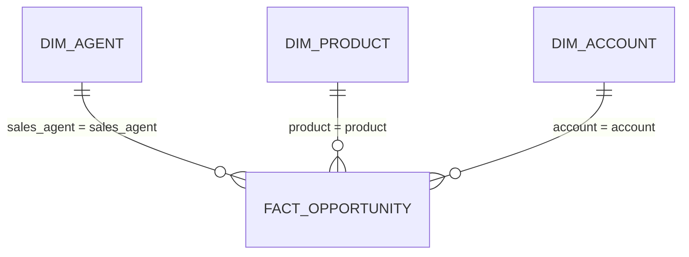

# 📊 B2B Sales Pipeline CRM Dashboard: Tableau & Power BI kit

Everything needed to rebuild this project as a Power BI and Tableau dashboard in under an hour: model-ready data, ready-to-paste DAX measures and Tableau calculated fields, a matching colour theme, a page-by-page layout, and the exact numbers your finished dashboard should show.

> **Interactive web version:** [scarface96.github.io/B2B-Sales-Pipeline-CRM-Dashboard-for-TechSolutions-Inc.](https://scarface96.github.io/B2B-Sales-Pipeline-CRM-Dashboard-for-TechSolutions-Inc./). The kit uses the same cleaned data, so the numbers will match.

## What's in this folder

| File | What it is |
|---|---|
| `data/fact_opportunity.csv` | one row per opportunity (8,800): stage, dates, close value, won/closed/open flags, sales cycle, deal age, and for Engaging deals the win probability, expected value and stale flag from the live report's forecast |
| `data/dim_agent.csv` | one row per sales agent: manager, regional office |
| `data/dim_product.csv` | one row per product: series, list price |
| `data/dim_account.csv` | one row per account: sector (typo fixed), revenue, employees, office location |
| `powerbi/measures.dax` | Every DAX measure, with its number format |
| `powerbi/theme.json` | Report theme in the portfolio's teal-and-amber colours |
| `tableau/calculated_fields.md` | Every calculated field, plus how to connect the tables |
| `tableau/Preferences.tps` | The same colours as Tableau palettes |
| `kpis.json` | Headline numbers, for checking your build |
| `build_bi.py` | Regenerates everything here from the repo's own cleaning code: `python -m bi.build_bi` |

## Data model

A star schema: one fact table, small lookup tables around it, single-direction many-to-one relationships.

## Dashboard design

Canvas 1280 × 720. Light page background, white cards, teal for the main series, amber to highlight, red only for bad news.

### Page 1: Executive summary
*How much are we winning, and where?*

- KPI cards: Won Revenue · Win Rate · Avg Won Deal · Weighted Pipeline
- Column chart: Won Revenue by close_quarter, with Win Rate as a line on the secondary axis
- Bar charts: Won Revenue by dim_product[series] and by dim_agent[regional_office]
- Slicers: regional office, manager

### Page 2: Agent performance
*Who wins, and is it skill or volume?*

- Table: sales_agent, manager, Won Deals, Won Revenue, Win Rate, Win Rate vs Team (conditional formatting: teal above, red below)
- Scatter: x = Closed Deals, y = Won Revenue, details = sales_agent, legend = regional_office (shows value tracks volume)
- Bar chart: Win Rate by agent with a constant line at Team Win Rate

### Page 3: Pipeline health
*How much of the open pipeline is real?*

- Cards: Engaging Deals · Stale Deals · Weighted Pipeline · Healthy Pipeline
- Stacked bar: Engaging Deals by sales_agent, legend = stale (rename 1/0 to Stale / Within normal cycle)
- Histogram: count of opportunities by age_days (bins of 30 days) for Engaging deals
- Funnel: Opportunities by deal_stage

## Build it in Power BI

1. **Get data → Text/CSV** and load each file in `bi/data/`. Check that date columns come in as *Date* and IDs as *Whole number* or *Text*.
2. In **Model view**, create the relationships (many-to-one, single direction): `fact_opportunity[sales_agent]` → `dim_agent[sales_agent]`; `fact_opportunity[product]` → `dim_product[product]`; `fact_opportunity[account]` → `dim_account[account]`.
3. **Home → Enter data**, name the table `_Measures`, load it, then add each measure from `powerbi/measures.dax` and set the format given above it.
4. **View → Themes → Browse for themes** → `powerbi/theme.json`.
5. Build the pages above. Add a title text box on each page with the question it answers.
6. Check your cards against **Check your numbers** below.
7. Save as `B2B Sales Pipeline CRM Dashboard.pbix` in the repo root.

## Build it in Tableau

1. Copy `tableau/Preferences.tps` to `Documents/My Tableau Repository/` (or merge its palettes into the one there) and restart Tableau.
2. Connect the data as described at the top of `tableau/calculated_fields.md`.
3. Create the calculated fields in that file.
4. Build one sheet per chart above, then a dashboard per page at 1280 × 720 (Fixed size). Use the *Tony Mulunda* palettes for colour.
5. Check your BANs against **Check your numbers** below.
6. **File → Save to Tableau Public**, then save the packaged workbook (`.twbx`) in the repo root.

## Check your numbers

Your finished dashboard (no filters applied) should show:

| Measure | Value |
|---|---|
| Opportunities | 8,800 |
| Won deals | 4,238 |
| Won revenue | 10,005,534 |
| Win rate (closed deals) | 63.1% |
| Average won deal | 2,360.91 |
| Median sales cycle (won, days) | 57 |
| Engaging deals | 1,589 |
| Weighted pipeline (Engaging) | 2,454,249 |
| Stale Engaging deals | 1,432 |
| Stale cutoff (days) | 106 |

If a number is off, the usual causes are a relationship pointing the wrong way, a date column loaded as text, or a missing join.

## Notes on the data

- Prospecting deals have no account yet, so `account` is blank on 1,425 rows. They appear as (Blank) in account visuals; that is expected.
- The stale cut-off (106 days) is the time within which 90% of won deals closed. Engaging deals older than that are flagged `stale = 1`.

## Publish and show it off

- **Tableau Public:** after saving, copy the share link and add it to the main README next to the live web report.
- **Power BI:** *Publish to web* needs a work or school account. Without one, add a screenshot of each page to `docs/images/` and link the `.pbix` from the README.
- Take a 1280 × 720 screenshot of page 1 and put it at the top of the main README, so it's the first thing a recruiter sees.
